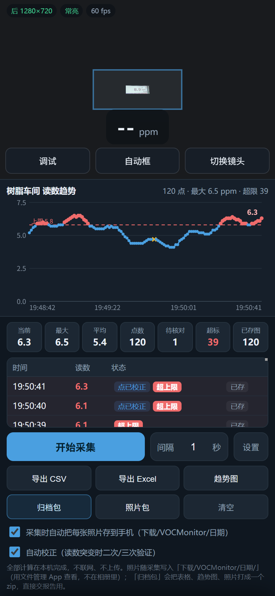
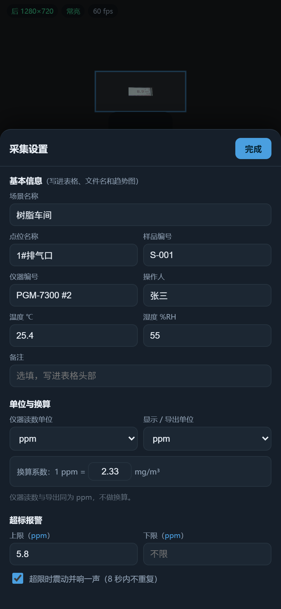
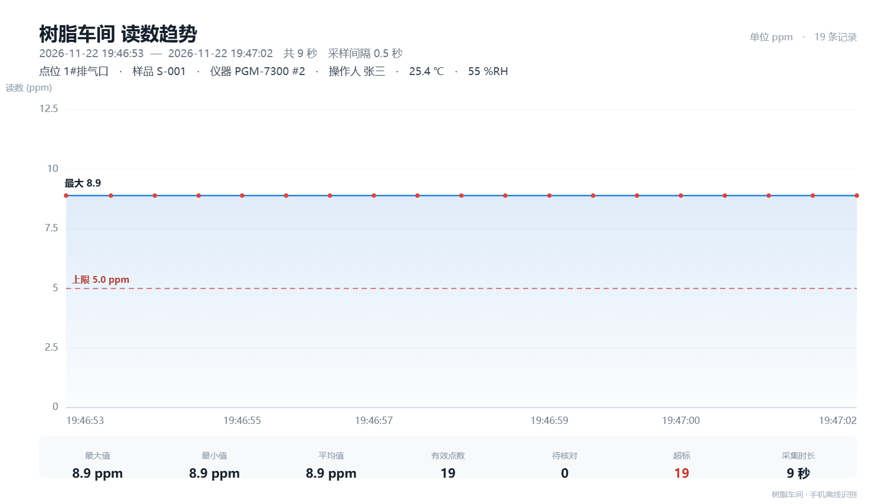

# 屏读采集 · Screen Reader for Gas Detectors

把便携式气体检测仪**液晶屏上的数字**，用手机摄像头自动读出来、画成曲线、导出成能直接进报告的表格。

> 本项目最初是为 **霍尼韦尔 PGM-7300（MiniRAE Lite / Lite+）VOC 检测仪**写的：这台仪器没有数据导出接口，做吸附/脱附实验时需要每隔几秒记录一次读数，靠人抄表既费人力又会漏点。于是就有了这个 App —— 把手机架在仪器前面，让它替人看表。
>
> 因为识别对象只是"屏幕上的一个数字"，同一个 APK 也可以用于其他只有屏幕、没有数据接口的便携式仪表（各种泵吸式/扩散式气体检测仪、部分流量计与温湿度表），只要把取景框套住数字区即可。



---

## 目录

- [它解决什么问题](#它解决什么问题)
- [功能](#功能)
- [快速开始：三种用法](#快速开始三种用法)
- [现场使用流程](#现场使用流程)
- [导出的数据长什么样](#导出的数据长什么样)
- [读数是怎么读准的](#读数是怎么读准的)
- [关于本项目的开发方式](#关于本项目的开发方式)
- [开发与构建](#开发与构建)
- [项目结构](#项目结构)
- [已知限制](#已知限制)
- [常见问题](#常见问题)
- [许可与声明](#许可与声明)

---

## 它解决什么问题

实验室里常见的场景：一台 PGM-7300 架在测试台上，屏幕上跳着 `5.6 ppm`，需要连续记录半小时到几小时。人工抄表的三个麻烦——

1. **间隔做不小**。1 秒一个点只能靠定时器加手写，实际很难低于 5 秒。
2. **人会走神**。峰值往往出现在换气、开盖、升温的那几十秒里，正好是人在低头写字的时候。
3. **事后没有证据**。记录表上只有数字，报告里要附过程曲线时无从下手。

这个 App 的做法是：手机固定在支架上，取景框套住液晶屏，按设定间隔（最低 0.5 秒）自动截图识别，把**读数、时间、置信度、原图**一起存下来，最后一次性导出 Excel、CSV、趋势图和照片归档包。

**全程离线**：识别模型（PP-OCRv3，约 13 MB）打包在 APK 内，不联网、不上传、不需要电脑，实验数据不出手机。

---

## 功能

| 模块 | 说明 |
| --- | --- |
| 取景与识别 | 四角可拖动的取景框；「自动框」按屏幕亮度找边界；前后摄像头切换；调试面板显示识别区、置信度、清晰度、耗时 |
| 定时采集 | 间隔 0.5–60 秒可调；屏幕常亮；采集时把每张照片裁到屏幕区域后写入手机 |
| 实时曲线 | 横轴时间、纵轴浓度；断采超过 2.5 倍间隔自动断开不连线，避免"其实停了 10 分钟"被画成直线 |
| 自动校正 | 读数跳变时自动重读，最多三次投票；小数点被误识别（`5.6→56`）也在这一步救回 |
| 单位换算 | 仪器单位 / 显示导出单位独立选择：ppm、ppb、mg/m³，换算系数可改（默认 2.33） |
| 超标报警 | 上下限可设；超限时数字变红、行标红、震动 + 提示音（8 秒内不重复） |
| 采集元数据 | 场景、点位、样品编号、仪器编号、操作人、温度、湿度、备注，写进表格表头、文件名与趋势图 |
| 导出 | CSV、Excel（xlsx）、趋势图 PNG、照片 zip、一键归档包（表格+趋势图+照片） |
| 崩溃兜底 | 每 3 秒把记录快照写进本地存储，App 被杀后重开可恢复未导出的数据 |

---

## 快速开始：三种用法

### 方式一：下载现成 APK（推荐给现场使用者）

到本仓库的 Actions 页面，点最新一次 **Build APK** → 页面底部 **Artifacts** → 下载 `screen-reader-apk`，解压得到 `app-debug.apk`，传到手机安装（需允许"安装未知来源应用"）。

也可以自己在 **Actions → Build APK → Run workflow** 触发一次编译，约 3–5 分钟。

> Debug 包用 Android 默认调试证书签名，自己装没问题；升级覆盖安装也是同一签名，已采集的数据不会丢。

### 方式二：自己构建

需要 Node 20+、JDK 17、Android SDK 34（详见 [开发与构建](#开发与构建)）：

```bash
git clone https://github.com/geek0hao/voc-reader-android.git
cd voc-reader-android
npm install
npm run cap:sync          # 把 web/ 复制到 www/ 并同步进安卓工程
cd android && ./gradlew assembleDebug
# 产物：android/app/build/outputs/apk/debug/app-debug.apk
```

### 方式三：当网页用（不装 App）

`web/` 目录本身就是一个 PWA，扔到任意 HTTPS 静态服务器上就能用浏览器打开（摄像头要求安全上下文，`localhost` 或 HTTPS 才行）。开发调试时可以直接跑仓库里的局域网服务器：

```bash
cd web
python serve_mobile.py            # 默认 8443，自签证书，终端会打印二维码
```

手机连同一个 WiFi 扫码打开，首次提示"证书不受信任"→ 高级 → 继续前往。适合先在一台机器上把取景框和识别参数调好，再打进 APK。

---

## 现场使用流程

1. **固定手机**。三脚架或磁吸支架，镜头正对仪器屏幕，距离 15–30 cm，避免强反光。斜拍也能用，但正对着识别率最高。
2. **点「调试」**，拖动四个角让蓝框贴住液晶屏边框。框内不要包含 Status、菜单栏等无关文字。
3. **可选：点「学习数字区」**。程序会记录数值在框内的相对位置，之后每帧只识别这一小块，速度更快、也更能抵抗反光。换仪器或移动手机后要重新学习。
4. **点「设置」**填采集元数据（点位、仪器编号等）、选单位、设上下限。这些会写进表格表头和文件名。
5. **点「开始采集」**。默认 5 秒一个点；做穿透曲线这类快过程可以调到 1 秒。
6. **结束后点「归档包」**，一个 zip 里包含 CSV、Excel、趋势图 PNG 和全部照片，直接拿去写报告。

> 采集期间请让 App 保持在前台（已锁定竖屏 + 屏幕常亮）。安卓会在 App 退到后台时冻结网页定时器，这是系统行为。切回前台会自动重新打开相机。



---

## 导出的数据长什么样

所有文件都写到手机的 **`下载/VOCMonitor/<日期>/`**（`VOCMonitor` 是早期版本留下的目录名，为兼容旧数据一直没改；App 的显示名后来改成了"屏读采集"）。用文件管理器查看，不会出现在相册里。

文件名规则：`<点位>_<种类>_<时间戳>`，例如 `1#排气口_数据_20261122_194708.xlsx`。

| 导出 | 内容 |
| --- | --- |
| CSV | 顶部若干行"键,值"的采集元数据 → 空行 → 数据表 |
| Excel | 同上，元数据在前，数据表带表头与列宽 |
| 趋势图 | 1600×900 PNG，标题为场景名，含限值虚线、超标点、最大/最小标注、七项统计 |
| 照片包 | 本次采集的照片 zip（只含裁剪后的屏幕区域） |
| 归档包 | CSV + XLSX + 趋势图 + 照片，一次打包 |

数据表列：

```
序号 | 时间 | 读数(选定单位) | 原始读数(仪器单位) | 状态 | 超限 | 置信度 | 校正 | 验证次数 | 图片文件
```

- **读数**按你选的导出单位换算后的值；**原始读数**是仪器屏幕上直接读到、未经换算的数字，方便和原始记录对照。
- **状态**为空表示正常，出现 `待复核` 表示三次验证结果不一致，建议人工核对这一行。
- **校正**说明这一行经过了什么处理（如"点已校正"），**验证次数**是这个点实际读了几次。
- **图片文件**对应 `下载/VOCMonitor/<日期>/` 里的照片文件名，方便抽查。

趋势图示例：



---

## 读数是怎么读准的

识别流程是 `检测(det) → 识别(rec) → 后处理 → 时序校正` 四步，全部在手机 CPU 上跑（onnxruntime-web 单线程 WASM）：

1. **检测**：DBNet（PP-OCRv3 det，2.4 MB）在取景框内找出每一行文字，把数值从单位、状态栏里分离出来。早期版本只有识别模型，把整块画面压成一行去认，屏幕上同时有多个数字时必然读乱。
2. **识别**：CRNN（PP-OCRv3 rec，11 MB）把单独一行数字识别成文本，输入高固定 48 px。
3. **后处理**：从原始文本枚举所有可能的读数——`5,6`、`5 6`、`56` 都可能是同一个值的不同误读——按"文本里是否本来就带小数点"给出不同权重。
4. **时序校正**：气体浓度在秒级尺度上变化平缓，所以当前帧的读数应该落在"由前几个点外推的位置"附近。候选值里挑最吻合趋势的那个；如果这一帧突然跳变，就**当场重读两帧**再投票（三次里两次一致即采信，互不相同时取最接近预测值并标记"待复核"）。

设计上有一条硬约束：**只做选择与复核，绝不凭空造数**。所有候选值都来自模型输出的文本，算法不参与"猜一个合理值"。真实浓度突然升高时，三次验证会一致地支持新值，算法不会把突变压平。

详细算法说明见 [docs/ARCHITECTURE.md](docs/ARCHITECTURE.md)。

---

## 关于本项目的开发方式

这个项目是**用 WorkBuddy 中的 DeepSeek V4.1 Flash 模型完成开发**的，属于"AI 全程写代码、人来定需求和验收"的协作方式，这里如实说明，方便你判断代码的可信度与维护成本。

具体分工：

- **人**：提出需求（"切后台再回来自动停用相机""5.6 被识别成 56""存了半小时只出了表格、图片没了并且闪退"）、描述现象、提供真机反馈、决定功能优先级、做最终验收。
- **DeepSeek V4.1 Flash（在 WorkBuddy 里）**：读官方手册确认仪器量程与单位，设计数据结构和界面，写网页端与安卓原生桥代码，写自动校正算法与 23 项单元测试，用 Chrome DevTools Protocol 驱动无头浏览器做端到端自动化测试（注入假摄像头画面、模拟半小时采集），定位 OOM 崩溃原因，编译并验签 APK。

几个能说明这个过程特点的例子：

- 小数点误识别不是靠"加个正则"解决的：改成候选枚举 + 时序择值，才同时兼顾 `5,6→5.6` 和真实整数读数。
- "提示保存了但没有文件、随后闪退"的根因是旧实现把上千张 JPEG 读进内存再 base64 过桥（峰值上 GB）。改成原生端流式 zip + 每写一张就释放 blob，并把桥接单次上限收到 10 MB。
- 每条易错逻辑在代码里都留了注释说明"为什么这么写"，因为 AI 写的代码如果不写清原因，下一个人（或下一轮对话）很容易把它改回去。

本次开源的仓库整理与文档撰写同样由该模型完成。

---

## 开发与构建

### 环境

| 组件 | 版本 |
| --- | --- |
| Node.js | 20 或 22 |
| JDK | 17 |
| Android SDK | platform 34、build-tools 34.0.0 |
| Gradle | 8.2.1（仓库自带 wrapper） |
| AGP | 8.2.1 |
| minSdk / targetSdk | 22 / 34 |

### 常用命令

```bash
npm install              # 安装 @capacitor 三件套
npm run cap:sync         # web/ → www/ → 安卓工程（改完网页代码就执行这个）
npm run sync:web         # 只做 web/ → www/ 的复制

cd android && ./gradlew assembleDebug     # 编 Debug APK
cd android && ./gradlew installDebug      # 直接装到已连接的手机
```

改完 `web/` 里的代码后必须 `npm run cap:sync`，否则装到手机上的还是旧资源 —— 这是 Capacitor 项目最容易踩的坑。

### 调试网页端

```bash
cd web && python serve_mobile.py
```

手机与电脑同一 WiFi，扫码打开。要改识别参数（检测阈值、ROI 位置）时，先在这里调到满意，再同步进 APK。

### 云端构建

`.github/workflows/build-apk.yml` 配好了：推送到 `main` 或在 Actions 页面手动触发，Ubuntu runner + JDK 17 + SDK 34 自动编译，产物上传为 artifact（保留 90 天）。公开仓库的 Actions 不计时长。

更多细节（如何换模型、如何加导出格式、如何做真机回归测试）见 [docs/DEVELOPMENT.md](docs/DEVELOPMENT.md)。

---

## 项目结构

```
.
├─ web/                        网页源码（唯一出处，纯静态，无框架无构建）
│  ├─ index.html               界面结构
│  ├─ style.css                样式（深色，单手操作布局）
│  ├─ app.js                   主逻辑：采集循环、曲线、导出、设置、崩溃恢复
│  ├─ ocr.js                   PP-OCRv3 det+rec 推理封装
│  ├─ autocorrect.js           时序校正：候选枚举、趋势预测、三次投票
│  ├─ sw.js                    Service Worker（仅供浏览器版离线缓存）
│  ├─ serve_mobile.py          局域网 HTTPS 调试服务器（自签证书+二维码）
│  ├─ assets/                  det 2.4 MB / rec 11 MB / 字符字典
│  └─ vendor/                  onnxruntime-web（ort.min.js + simd wasm）
├─ android/                    Capacitor 安卓工程
│  └─ app/src/main/java/cn/voc/reader/
│     ├─ MainActivity.java     注册原生插件、屏幕常亮
│     └─ NativeBridgePlugin.java  MediaStore 写文件 / 流式 zip / 版本号
├─ scripts/copy-web.mjs        web/ → www/ 的资源同步
├─ .github/workflows/          云端编译 APK
├─ docs/                       架构说明、开发说明、截图
├─ capacitor.config.json       appId / 应用名 / webDir
└─ package.json
```

`www/` 是构建产物，不进仓库，由 `npm run sync:web` 生成。

---

## 已知限制

- **不能后台采集**。锁屏或切到别的 App 会停（网页定时器被系统冻结）。长时间实验请插充电宝并保持前台。
- **强反光、低对比度屏幕**识别率会下降。倾斜角度过大、屏幕有划痕、镜头脏都会影响；调试面板里的"清晰度"掉到很低时应当调整。
- **斜拍近景**可能自动框选不到，手动拖框即可；框的位置会记在本地。
- **只在 PGM-7300 上做过完整真机验证**。其他仪器理论上可用，但量程、小数位数、单位需要自行在设置里配。
- **Debug 版未做 release 签名**，不适合发应用商店；如需分发请自行配置签名并生成 AAB。
- 崩溃恢复只恢复"未导出"的记录，且不含照片（照片已单独落盘）。

---

## 常见问题

**Q：为什么保存目录叫 VOCMonitor，App 却叫"屏读采集"？**
A：v1.0 叫 VOC 读数采集，目录名 `VOCMonitor` 已经写进不少人的旧数据里，改名时为了不打断已有文件，只改了显示名。

**Q：采集到一半接电话、切出去，回来相机黑屏怎么办？**
A：v1.5 起会自动恢复（检测到视频轨不是 live 状态就重开相机，带三次退避重试）。如果仍然黑屏，点「切换镜头」再切回来可以强制重开。

**Q：读数偶尔标"待复核"是什么意思？**
A：这个点三次读取结果不一致，程序按趋势选了最接近的一个，但提醒你人工看一眼。长时间实验里出现个位数百分比属正常。

**Q：能识别负值或超过 5000 的值吗？**
A：候选值会被限制在 0–5000 ppm（PGM-7300 的量程），超出的候选直接丢弃，避免把噪点认成天文数字。换别的仪器需要改 `web/autocorrect.js` 顶部的 `RANGE_MIN/RANGE_MAX`。

**Q：照片占多大空间？**
A：单张只存裁剪后的屏幕区域，JPEG 约 15–20 KB。1 秒间隔约 60 MB/小时，5 秒间隔约 12 MB/小时。

---

## 许可与声明

- 本项目代码以 **MIT License** 发布，见 [LICENSE](LICENSE)。
- 识别模型为百度 **PP-OCRv3**（Apache-2.0），推理引擎为 **ONNX Runtime Web**（MIT），两者均随仓库分发，遵循各自许可。
- 本项目与 **霍尼韦尔（Honeywell）** 无任何隶属或背书关系，`PGM-7300`、`MiniRAE` 等为其商标，此处仅用于说明适配对象。
- 本软件是实验辅助工具，**不能替代仪器本身的读数与安全联锁**。涉及人身安全的场合，请以仪器显示与持证人员判断为准。
